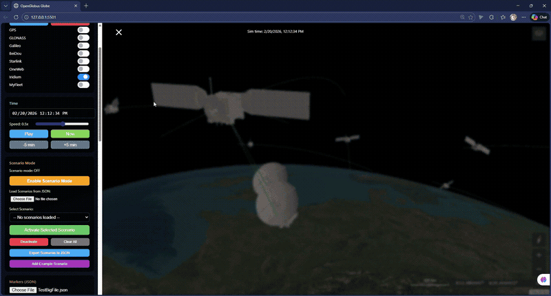
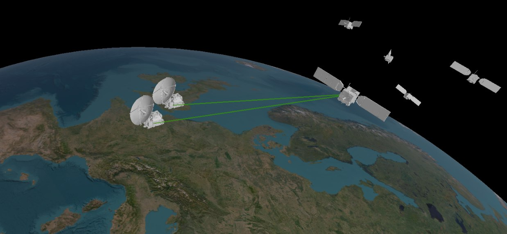
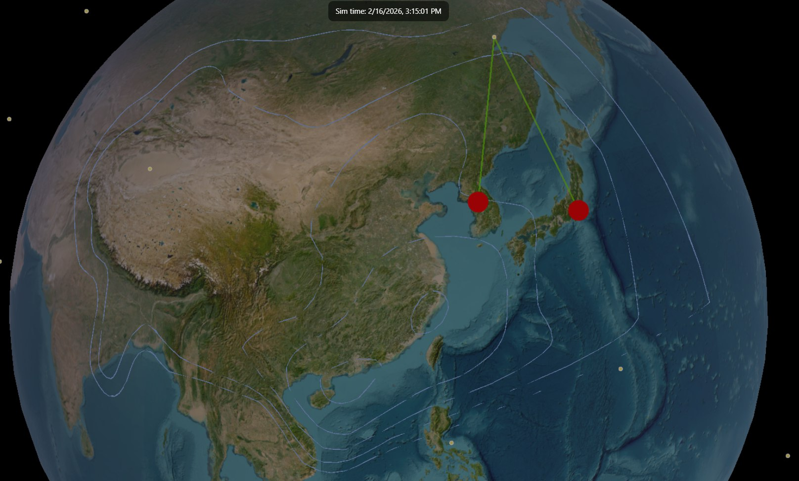
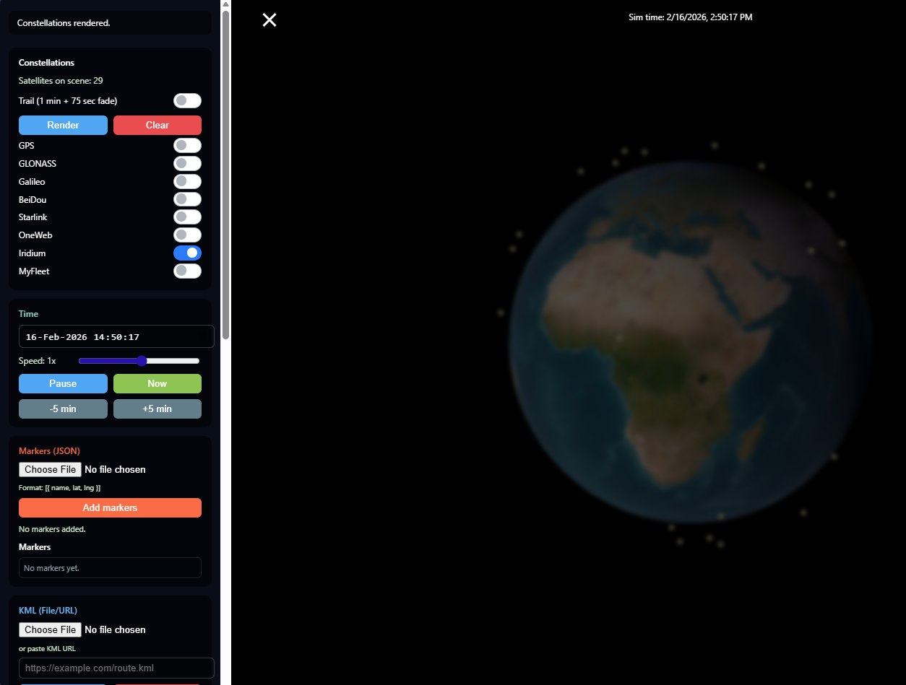

<div align="center">

# 🛰️ Satellite Tracker — Real-Time 3D Globe with TLE Propagation

**An interactive WebGL application that visualizes satellite constellations in real time, simulates ground-station antenna tracking and models communication windows — built on [OpenGlobus](https://www.openglobus.org/).**




</div>

---

## Overview

This project is a browser-based **satellite visualization and simulation tool**. It loads real orbital data in **TLE** (Two-Line Element) format, propagates every satellite's position in real time with the **SGP4** model, and renders them as oriented **3D glTF models** on a WebGL globe.

On top of the visualization it adds a small **ground-segment simulation layer**: ground stations with 3D dish antennas that physically rotate to follow the nearest visible satellite, line-of-sight rays that are blocked by the Earth, paired stations that negotiate a *shared* satellite, and a **scenario engine** that plays back time windows describing which satellite is active and when.

It was designed as a practical, dependency-light application: plain ES modules, no bundler, no framework — open it through any static server and it runs.

## Screenshots

<table>
  <tr>
    <td width="50%"></td>
    <td width="50%"></td>
  </tr>
  <tr>
    <td align="center"><sub><b>3D models</b> — dish antennas tracking an oriented satellite, with distance-coloured rays</sub></td>
    <td align="center"><sub><b>Paired stations</b> — two ground points resolved to one common satellite, plus a KML overlay</sub></td>
  </tr>
</table>

<div align="center">
  
  <br><sub><b>Control panel</b> — constellations, simulation clock, marker import and KML layers</sub>
</div>

## Key Features

| Area | What it does |
|---|---|
| **Constellations** | GPS, GLONASS, Galileo, BeiDou, Starlink, OneWeb and Iridium loaded from TLE sources, each with its own colour. Local files are tried first for speed, with CelesTrak and CORS-proxy fallbacks. |
| **Orbit propagation** | Real-time **SGP4** propagation via `satellite.js`; ECI → geodetic conversion on every frame. |
| **3D models** | Satellites are rendered as **glTF** models, oriented along their velocity vector using a quaternion built from the orbital frame. |
| **Orbit trails** | Optional fading polyline trails, coloured per constellation. |
| **Simulation clock** | Speed from **−20× to +20×**, pause, "Now", ±5 min steps and date picker — all driven by an anchor-based time model so changes never cause jumps. |
| **Ground stations** | Import stations from JSON. Each gets a 3D dish antenna that smoothly slews (azimuth/elevation, shortest-arc interpolation) toward the nearest satellite above a minimum elevation. |
| **Line-of-sight rays** | Rays to reachable satellites, coloured by distance (green → red), with a segment-vs-sphere test so **no ray passes through the Earth**. |
| **Station pairs** | Two stations look for one **common** satellite; if none exists, each falls back to its own nearest one. |
| **Scenario mode** | JSON scenarios with time windows, safety margins, auto-loaded constellations, custom satellites and a ground point. The active satellite is highlighted (scaled up, gold trail) with a live window status. |
| **Custom satellites** | Add any satellite by pasting a TLE, with its own colour and speed multiplier. |
| **KML support** | Load KML overlays from a file or URL, fly to their extent, remove them individually. |
| **Satellite tracking** | Pick any visible satellite from the live list and follow it with a selection ring. |

## Tech Stack

| Layer | Technology |
|---|---|
| **3D globe / rendering** | [**OpenGlobus**](https://www.openglobus.org/) (`@openglobus/og`) — WebGL globe, vector layers, entities, glTF, KML, layer switcher |
| **Orbital mechanics** | [**satellite.js**](https://github.com/shashwatak/satellite-js) — SGP4/SDP4 propagation, GMST, ECI/geodetic transforms |
| **Language** | Vanilla **JavaScript (ES Modules)**, HTML5, CSS3 |
| **3D assets** | glTF 2.0 models (satellite, dish antenna) |
| **Map imagery** | Esri World Imagery, Esri Clarity, OpenStreetMap |
| **Data** | TLE (CelesTrak), JSON (markers, station pairs, scenarios), KML |

No framework and no build step: the app is a static site.

## Architecture

```
index.html          Page shell and sidebar markup
main.js             Entry point: creates the Globe, wires modules, owns the per-frame draw loop
config/             Constellation sources and base map layers
services/
  tle.js            TLE parsing and resilient multi-source fetching
  satellites.js     Core simulation: propagation, orientation, trails
  Gettersline.js    Ground stations, station pairs, rays, antenna tracking, geometry
  scenarios.js      Scenario model and time-window logic
ui/                 Sidebar panels: time, constellations, markers, scenarios, KML
data/               Local TLE files and example scenarios
res/models/         glTF models
vendor/             satellite.js (ES build)
```

**Data flow:** every frame, the draw loop asks the time model for the simulated date, propagates each visible satellite with SGP4, updates its position and orientation, extends its trail, then recomputes rays and rotates the antennas. Simulation speed therefore scales satellite motion directly.

## Engineering Highlights

- **Orientation from orbital state** — builds an orthonormal basis from position and velocity and converts it to a quaternion, so each satellite model faces along its track.
- **Earth-occlusion test** — ray/segment–sphere intersection prevents unphysical links through the planet.
- **Shared-satellite resolution** — partitions reachable satellites into *common / only-A / only-B* sets per station pair, then picks the best candidate.
- **Smooth antenna slewing** — shortest-arc angle interpolation with an idle sweep when no target is in range.
- **Jump-free simulation time** — an anchor + speed model re-anchors on every speed or pause change.
- **Resilient data loading** — each constellation tries a local file first, then CelesTrak, then public CORS proxies.

## Getting Started

The app uses `fetch` for TLE files and glTF models, so it must be served over HTTP (opening `index.html` via `file://` will not work).

```bash
# clone
git clone https://github.com/L3sh1y-5308/MyStudentWork_TLE_KML.git
cd MyStudentWork_TLE_KML

# serve with any static server, for example:
npx serve .
# or
python -m http.server 8000
```

Then open the printed address (e.g. `http://localhost:8000`).

### Quick tour

1. Open the **☰ menu**, toggle one or more constellations and press **Render**.
2. Use the **Time** panel to speed up, pause or jump the simulation clock.
3. Under **Markers (JSON)** load stations to see antennas and rays appear.
4. Load a **scenario** and press *Activate* to jump to its start time and highlight the active satellite.

## Input Formats

**TLE** (three lines per satellite — name, line 1, line 2)
```
STARLINK-1008
1 44714U 19074B   26019.33335648  .01367809  00000+0  58387-1 0  9999
2 44714  53.1090  47.8537 0002094  77.5814  56.2394 15.19580678  5791
```

**Ground stations**
```json
[{ "name": "Moscow", "lat": 55.755, "lng": 37.617 }]
```

**Station pairs**
```json
{
  "getterPairs": [{
    "pairId": "pair1",
    "getters": [
      { "name": "A", "lon": 37.6, "lat": 55.7 },
      { "name": "B", "lon": 37.8, "lat": 55.8 }
    ]
  }]
}
```

**Scenario** (abridged)
```json
{
  "scenarios": [{
    "name": "Demo pass",
    "date": "2026-02-17",
    "startTime": "09:00",
    "constellations": ["Starlink"],
    "getterPoint": { "lon": 30.5, "lat": 50.4, "name": "Kyiv" },
    "windows": [{ "satelliteName": "STARLINK-1008", "startTime": "12:00", "endTime": "12:55" }],
    "safetyWindow": 5
  }]
}
```

More examples live in [`data/`](data/) and detailed notes in [`DocumentationFolder/`](DocumentationFolder/).

## Roadmap

- [ ] Migrate the UI to **React + TypeScript** (engine stays imperative, panels become components with a shared store)
- [ ] Move SGP4 propagation to a **Web Worker** for large constellations
- [ ] Switch to instanced rendering / LOD for thousands of Starlink satellites
- [ ] Replace the flat-earth distance/elevation approximations with proper ECEF/ENU geometry
- [ ] Pin dependency versions and add unit tests for the geometry and scenario logic

## About

Built as a student project in satellite visualization and ground-segment simulation, with the goal of combining orbital mechanics, 3D graphics and interactive tooling in a single web application.

**Author:** [Lesh1y](https://github.com/L3sh1y-5308)

## Acknowledgements

- [OpenGlobus](https://www.openglobus.org/) for the WebGL globe engine
- [satellite.js](https://github.com/shashwatak/satellite-js) for SGP4 propagation
- [CelesTrak](https://celestrak.org/) for public TLE data
